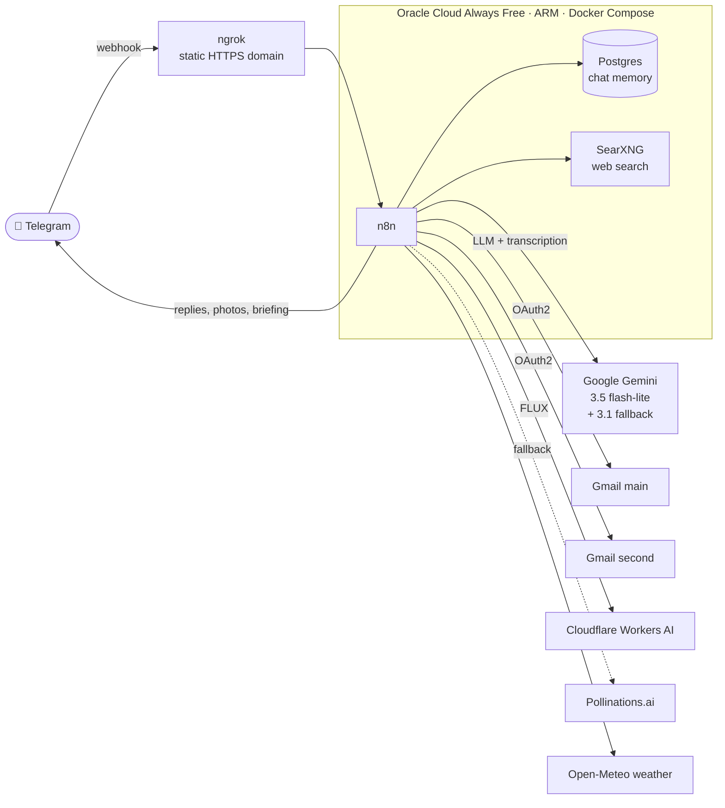
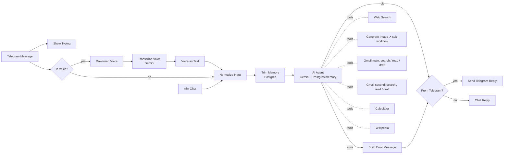

# 🤖 n8n Personal AI Assistant

A self-hosted personal AI assistant built with **n8n**, reachable 24/7 on **Telegram** (text and voice), running entirely on **free tiers** on an Oracle Cloud ARM server.

It reads and drafts emails across **two Gmail accounts**, searches the web through a **self-hosted search engine**, generates **images**, remembers conversations in **Postgres**, and sends a **morning briefing** every day.

> Built by [Muttu Manjunath](https://www.linkedin.com/in/muttu-manjunath-8546391ab), M.Eng. student in Advanced Industrial Engineering at TH Rosenheim.

---

## ✨ Features

| Feature | How it works |
|---|---|
| 💬 **Telegram chat** | Telegram webhook → n8n AI Agent → reply (restricted to the owner's Telegram user ID) |
| 🎤 **Voice messages** | Voice note downloaded → transcribed by Gemini → handled like typed text |
| 🧠 **Persistent memory** | Postgres Chat Memory, auto-trimmed to the last 6 user turns so Gemini never gets a broken history; survives restarts |
| 📧 **Two Gmail accounts** | Search, read and **draft** (never sends) for each account; results tagged per account |
| 🔎 **Web search** | Self-hosted **SearXNG** (Google, Bing, DDG, …), no API key, no limits |
| 🎨 **Image generation** | **Cloudflare Workers AI FLUX-1-schnell** (free daily quota) with automatic **Pollinations.ai** fallback |
| 🌅 **Morning briefing** | Daily 07:30: local weather (Open-Meteo) + important unread mail from both inboxes |
| ⚠️ **Error alerts** | Failures are explained in Telegram (rate limit, expired login, …) instead of silence |
| ⌨️ **UX touches** | "typing…" indicator, Markdown → Telegram HTML conversion, 4,000-char safety cap |
| 🛡️ **Guardrails** | No email sending, no images of real people, max tool calls per message |

---

## 🏗️ Architecture



### Main workflow: `Personal AI Assistant`



---

## 📁 Repository structure

```
workflows/
  personal-ai-assistant.json   # main Telegram agent (28 nodes)
  morning-briefing.json        # daily 07:30 briefing
  image-generator.json         # sub-workflow: Cloudflare FLUX -> Telegram, Pollinations fallback
infra/
  docker-compose.yml           # n8n + Postgres + SearXNG + ngrok
  .env.example                 # secrets template
  searxng/settings.example.yml # enables JSON output for the search tool
  backup.sh                    # nightly backup, 7-day retention
docs/
  setup.md                     # full step-by-step deployment guide
  design-decisions.md          # why things are built this way + lessons learned
```

---

## 🚀 Quick start

```bash
git clone https://github.com/muttumanjunath/n8n-personal-ai-assistant.git
cd n8n-personal-ai-assistant/infra
cp .env.example .env                                   # fill in ngrok token, domain, Postgres password
cp searxng/settings.example.yml searxng/settings.yml   # set secret_key
docker compose up -d
```

Then in n8n:
1. Import `workflows/image-generator.json`, publish it, and note its workflow ID.
2. Import `personal-ai-assistant.json` and `morning-briefing.json`.
3. Create the credentials (Telegram, Gemini, Gmail ×2, Postgres, Cloudflare) and select them on the nodes.
4. Replace the placeholders: `YOUR_TELEGRAM_USER_ID`, `YOUR_CLOUDFLARE_ACCOUNT_ID`, `IMAGE_GENERATOR_WORKFLOW_ID`, example email addresses.
5. Publish.

The full guide, including the Oracle Cloud VM, Google OAuth and Cloudflare setup, is in **[docs/setup.md](docs/setup.md)**.

---

## 💸 Cost: €0 / month

| Component | Free tier used |
|---|---|
| Server | Oracle Cloud Always Free (Ampere A1, 2 OCPU / 12 GB) |
| Public HTTPS | ngrok free static domain |
| LLM + speech-to-text | Google Gemini API free tier (flash-lite) |
| Images | Cloudflare Workers AI free daily neurons, plus Pollinations.ai |
| Search | Self-hosted SearXNG |
| Weather | Open-Meteo (no key) |

---

## 🔒 Security & privacy

- No secrets in this repo: credential IDs, tokens, user IDs and account IDs are replaced with placeholders.
- The bot only answers the owner's Telegram user ID.
- n8n login protected with 2FA; the editor is reachable only through the ngrok HTTPS domain.
- Email: **drafts only**, the assistant can never send mail.
- Images: the agent refuses to generate images of real, identifiable people.

## 🛠️ Tech stack

`n8n` · `Docker Compose` · `Postgres` · `SearXNG` · `ngrok` · `Google Gemini` · `Cloudflare Workers AI (FLUX)` · `Telegram Bot API` · `Gmail API (OAuth2)` · `Oracle Cloud (ARM)`

## 📄 License

MIT
