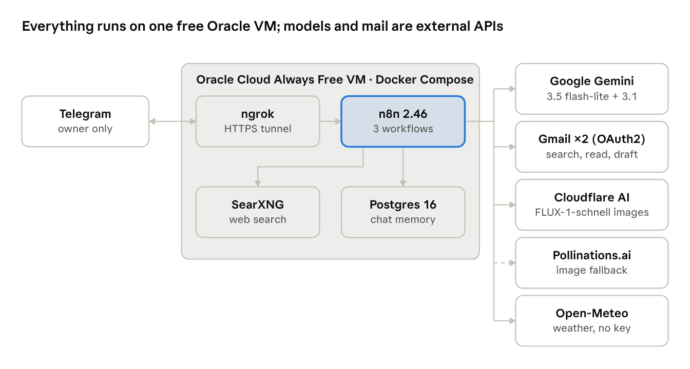
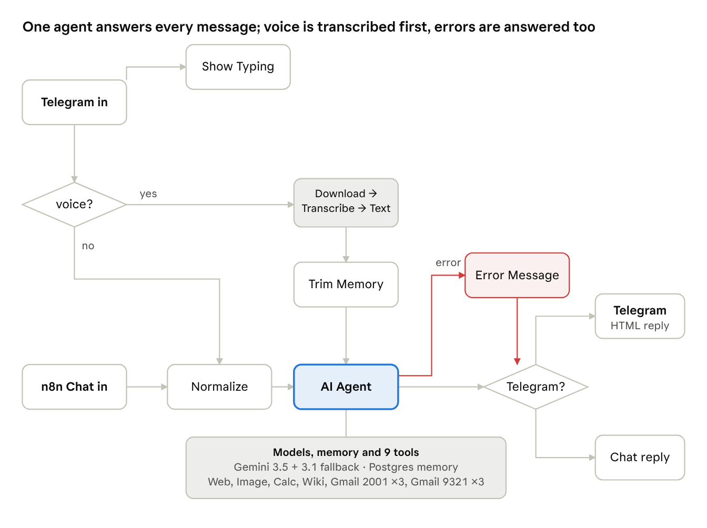
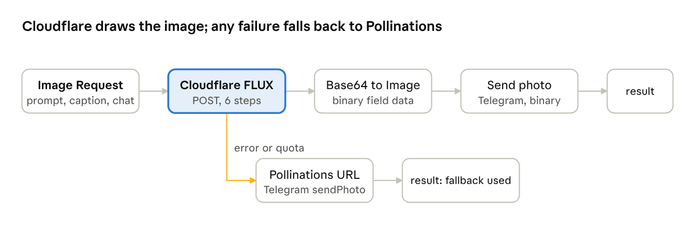

# Oppenheimer Personal AI Assistant — Technical Documentation

_As of 19 Nov 2026 · Muttu Manjunath_

Oppenheimer is a self-hosted personal AI assistant built on n8n 2.46 that runs 24/7 on an Oracle Cloud Always Free ARM server and answers on Telegram by text or voice. It uses Google Gemini as its model, keeps conversation memory in Postgres, and has tools for web search (self-hosted SearXNG), image generation (Cloudflare Workers AI with a Pollinations fallback), arithmetic, Wikipedia and two Gmail accounts (search, read and draft; it can never send). Three n8n workflows make up the system: the assistant itself (28 nodes), a daily morning briefing (8 nodes) and an image-generator sub-workflow (7 nodes). Total running cost is €0 per month.

## Contents

1. [System architecture](#1-system-architecture)
2. [Infrastructure](#2-infrastructure)
3. [Credentials](#3-credentials)
4. [Workflow 1 — Personal AI Assistant](#4-workflow-1--personal-ai-assistant)
5. [Workflow 2 — Morning Briefing](#5-workflow-2--morning-briefing-telegram)
6. [Workflow 3 — Image Generator](#6-workflow-3--image-generator-cloudflare--fallback)
7. [Data model](#7-data-model)
8. [Error handling and limits](#8-error-handling-and-limits)
9. [Security](#9-security)
10. [Operations](#10-operations)

## 1. System architecture



Telegram delivers each message to n8n through the ngrok tunnel; n8n keeps memory in Postgres and searches through SearXNG on the same host, and calls Gemini, Gmail, Cloudflare and Open-Meteo over the internet. Pollinations (dashed) is used only when Cloudflare fails or its daily quota is used up.

| Layer | Component | Role |
| --- | --- | --- |
| Channel | Telegram Bot API | Text and voice in, text and photos out; restricted to one user ID |
| Ingress | ngrok free static domain | Public HTTPS URL for the Telegram webhook, Gmail OAuth callback and the n8n editor |
| Orchestration | n8n 2.46.6 (Docker) | Runs the three workflows |
| Memory | Postgres 16 (Docker) | Table `n8n_chat_histories`, one row per message |
| Search | SearXNG (Docker) | Meta-search over Google, Bing, DuckDuckGo and others; JSON output enabled |
| LLM | Google Gemini API, free tier | `gemini-3.5-flash-lite` primary, `gemini-3.1-flash-lite` fallback; also speech-to-text |
| Mail | Gmail API via OAuth2 | Two accounts, read and draft only |
| Images | Cloudflare Workers AI `@cf/black-forest-labs/flux-1-schnell` | About 10,000 free neurons per day; Pollinations.ai as fallback |
| Weather | Open-Meteo | Daily forecast for Rosenheim, no API key |

## 2. Infrastructure

The whole stack is one `docker-compose.yml` (see [`infra/`](../infra)) started with `docker compose up -d`; every container restarts automatically after a reboot.

| Item | Value |
| --- | --- |
| Cloud | Oracle Cloud Infrastructure, Always Free tier, region Germany Central (Frankfurt) |
| Instance | VM.Standard.A1.Flex (Ampere ARM), 2 OCPU, 12 GB RAM, 47 GB boot volume |
| OS | Ubuntu 24.04 LTS, Docker CE from get.docker.com |
| Network | Own VCN with public subnet and internet gateway; ephemeral public IPv4; inbound SSH only |
| Public URL | ngrok free static domain |
| Timezone | Europe/Berlin on every container (`GENERIC_TIMEZONE`, `TZ`) |

### Containers

| Service | Image | Purpose | Persistent data |
| --- | --- | --- | --- |
| n8n | `docker.n8n.io/n8nio/n8n` | Workflow engine and editor | `n8n_data` → `/home/node/.n8n` (SQLite DB, credentials, settings) |
| postgres | `postgres:16-alpine` | Chat memory, database `n8n_memory`, user `n8n` | `pg_data` |
| searxng | `searxng/searxng:latest` | Meta-search engine, JSON API on port 8080 inside the Compose network | `searxng/settings.yml` |
| ngrok | `ngrok/ngrok:latest` | `http --url=https://<domain> n8n:5678` | none |

Key n8n environment variables: `WEBHOOK_URL=https://<domain>/`, `N8N_HOST=<domain>`, `N8N_PROTOCOL=https`, `N8N_PROXY_HOPS=1`. Secrets (`NGROK_AUTHTOKEN`, `NGROK_DOMAIN`, `POSTGRES_PASSWORD`) live in `.env` (mode 600) and are never committed.

### Backup

A cron job at 03:00 daily runs [`infra/backup.sh`](../infra/backup.sh): it dumps the memory database with `pg_dump`, then archives `n8n_data`, `docker-compose.yml`, `.env`, `searxng/` and the dump into `backups/n8n-YYYY-MM-DD.tar.gz`, keeping the last 7 days.

## 3. Credentials

Six credentials are stored encrypted inside n8n; no secret appears in any workflow parameter or in this repository.

| Credential (n8n name) | n8n type | Used by | Source |
| --- | --- | --- | --- |
| Telegram account | Telegram API (bot token) | Telegram Message, Show Typing, Download Voice, Send Telegram Reply, Send to Telegram, both image send nodes | @BotFather → `/newbot` |
| Google Gemini(PaLM) Api account | Google Gemini (PaLM) API key | Gemini Model, Gemini Fallback, Transcribe Voice, Write Briefing | aistudio.google.com/apikey, free tier |
| Gmail 2001 | Gmail OAuth2 | Search/Read/Draft 2001, Fetch Unread 2001 | Google Cloud OAuth client "Web application", redirect `https://<domain>/rest/oauth2-credential/callback`; app published to production so tokens do not expire after 7 days |
| Gmail 9321 | Gmail OAuth2 | Search/Read/Draft 9321, Fetch Unread 9321 | Same OAuth client, signed in with the second account |
| Postgres account | Postgres | Conversation Memory, Trim Memory | Host `postgres`, DB `n8n_memory`, user `n8n`, port 5432, SSL off |
| Cloudflare AI | Header Auth (`Authorization: Bearer <token>`) | Cloudflare FLUX | Cloudflare dashboard → API Tokens → "Workers AI" template |

SearXNG, Pollinations and Open-Meteo need no credential.

## 4. Workflow 1 — Personal AI Assistant

File: [`workflows/personal-ai-assistant.json`](../workflows/personal-ai-assistant.json), 28 nodes. Two triggers (Telegram, n8n Chat) feed one AI Agent; the agent's success output and its error output both end at the same reply switch, so the user always gets an answer.



A Telegram message first fires the typing indicator and the voice check in parallel; voice notes go through the transcription branch and rejoin at Normalize. Trim Memory runs before the agent so the history Gemini receives always starts with a user turn.

### 4.1 Intake nodes

| Node | Type (version) | Configuration |
| --- | --- | --- |
| Telegram Message | Telegram Trigger (1.5) | Updates: `message`. Restrict to User IDs: the owner's numeric Telegram ID (other users are ignored). Credential: Telegram account. |
| Chat with Assistant | Chat Trigger (1.5) | Public: off (editor-only test chat). Response mode: `lastNode`. |
| Show Typing | Telegram (1.2) | Operation `sendChatAction`, action `typing`, chat ID `{{ $json.message.chat.id }}`. On error: continue. |
| Is Voice? | If (2.2) | `{{ $json.message?.voice?.file_id ?? $json.message?.audio?.file_id ?? '' }}` is not empty. True → Download Voice, false → Normalize Input. |

### 4.2 Voice to Text group

| Node | Type (version) | Configuration |
| --- | --- | --- |
| Download Voice | Telegram (1.2) | Resource file, get, File ID from `message.voice` or `message.audio`, download on, MIME `audio/ogg`. Output: binary field `data`. |
| Transcribe Voice | Google Gemini (1.2) | Resource audio, transcribe, model `models/gemini-3.5-flash-lite`, input binary `data`. Retry: 2 tries, 5 s apart. |
| Voice as Text | Edit Fields (3.4) | Rebuilds `message` with `text` = `'[Voice message] ' + transcript`, so the item looks exactly like a typed message. |

### 4.3 Prepare group

| Node | Type (version) | Configuration |
| --- | --- | --- |
| Normalize Input | Edit Fields (3.4) | Four fields: `chatInput`, `sessionId` (`tg-<chat id>` for Telegram), `source` (`telegram` or `chat`), `telegramChatId`. |
| Trim Memory | Postgres (2.8) | Execute query with `$1` = `{{ $json.sessionId }}`; deletes rows older than the 6th-newest human message (section 7). Execute once, always output data, on error continue. |

### 4.4 AI Agent group

| Node | Type (version) | Configuration |
| --- | --- | --- |
| Personal AI Assistant | AI Agent (3.1) | Prompt `{{ $('Normalize Input').item.json.chatInput }}`. Max iterations 5, streaming off, fallback model enabled. On error: error output → Build Error Message. System message: identity and Berlin date/time; the two Gmail accounts with rules (check both when unspecified, label [2001]/[9321], read with the matching account's tool, draft from 2001 by default, never send, **never describe an inbox without a successful search in the same message**); tool list; no images of real people; max 3 tool calls per message; concise style in the user's language. |
| Gemini Model | Google Gemini Chat Model (1.2) | `models/gemini-3.5-flash-lite`, temperature 0.4, max tokens 4096, no node-level retry (a rate limit falls through to the fallback at once). |
| Gemini Fallback | Google Gemini Chat Model (1.2) | `models/gemini-3.1-flash-lite`, same options; agent's second model input; separate free quota. |
| Conversation Memory | Postgres Chat Memory (1.4) | Custom key `{{ $('Normalize Input').item.json.sessionId }}`, table `n8n_chat_histories`, window 20. |
| Calculator | Calculator tool (1) | No parameters. |
| Wikipedia | Wikipedia tool (1) | No parameters. |
| Web Search | HTTP Request tool (4.5) | GET `http://searxng:8080/search`, `q` from `$fromAI`, `format=json`, timeout 15 s; optimize response: data field `results`, fields `title,url,content,publishedDate`. |
| Generate Image | Call n8n Workflow tool (2.2) | Calls the Image Generator with `prompt`, `caption` (from `$fromAI`) and `chatId`. |
| Search Emails 2001 / 9321 | Gmail tool (2.2) | Message getAll, limit 10, simple, read status both, `q` from `$fromAI` (Gmail search syntax). |
| Read Email 2001 / 9321 | Gmail tool (2.2) | Message get by ID from `$fromAI`, simple off (full body). |
| Create Draft 2001 / 9321 | Gmail tool (2.2) | Draft create; subject, message, sendTo from `$fromAI`. No send operation exists anywhere. |

### 4.5 Error Handling and Reply groups

| Node | Type (version) | Configuration |
| --- | --- | --- |
| Build Error Message | Edit Fields (3.4) | Maps `$json.error`: 429/quota → "Gemini free limit reached", 401/403/invalid_grant → "a login expired, reconnect Gmail", 404 → "model not found", timeout → "try again"; appends the first 300 characters of the error. |
| From Telegram? | If (2.2) | `source` equals `telegram`. True → Send Telegram Reply, false → Chat Reply. |
| Send Telegram Reply | Telegram (1.2) | sendMessage, parse mode HTML, attribution off. Text cut to 4,000 chars, HTML-escaped, Markdown → `<b>`, `<i>`, `<code>`, bullets → `•`. |
| Chat Reply | Edit Fields (3.4) | `output` = `$json.output` for the Chat Trigger. |

## 5. Workflow 2 — Morning Briefing (Telegram)

File: [`workflows/morning-briefing.json`](../workflows/morning-briefing.json), 8 nodes. Every day at 07:30 Europe/Berlin it sends one Telegram message with the Rosenheim weather and the important unread mail of the last 24 hours from both accounts. The chain is linear:

1. Every Morning 07:30
2. Fetch Unread 2001
3. Collect 2001
4. Fetch Unread 9321
5. Collect 9321
6. Rosenheim Weather
7. Write Briefing
8. Send to Telegram

| Node | Type (version) | Configuration |
| --- | --- | --- |
| Every Morning 07:30 | Schedule Trigger (1.4) | Daily at 07:30. |
| Fetch Unread 2001 / 9321 | Gmail (2.2) | getAll, limit 20, `is:unread newer_than:1d in:inbox -category:promotions -category:social`. Always output data (empty inbox still continues). |
| Collect 2001 / 9321 | Aggregate (1) | All item data into field `emails`. |
| Rosenheim Weather | HTTP Request (4.3) | Open-Meteo daily forecast (lat 47.8571, lon 12.1181). Execute once; on error continue. |
| Write Briefing | Google Gemini (1.2) | `gemini-3.5-flash-lite`, temperature 0.3, max tokens 1024. Prompt holds date, weather JSON and both accounts' emails; asks for weather in words, Main (2001) and Second (9321) sections, urgent items first, no newsletters, max 20 lines, never invent emails. Retry 3×. |
| Send to Telegram | Telegram (1.2) | sendMessage, HTML, same Markdown conversion as the assistant. |

## 6. Workflow 3 — Image Generator (Cloudflare + fallback)

File: [`workflows/image-generator.json`](../workflows/image-generator.json), 7 nodes. Called by the assistant's Generate Image tool. The image is sent to Telegram from inside this workflow, because an agent tool cannot return binary data.



| Node | Type (version) | Configuration |
| --- | --- | --- |
| Image Request | Execute Workflow Trigger (1.3) | Inputs `prompt`, `caption`, `chatId`. |
| Cloudflare FLUX | HTTP Request (4.3) | POST `.../accounts/<account id>/ai/run/@cf/black-forest-labs/flux-1-schnell`, header auth, body `{ prompt, steps: 6 }`, timeout 60 s. Error output → fallback. |
| Base64 to Image | Convert to File (1.2) | `result.image` → binary `data`. |
| Send Cloudflare Image | Telegram (1.2) | sendPhoto from binary `data`, caption from request. |
| Result Cloudflare | Edit Fields (3.4) | Returns a success sentence to the agent. |
| Fallback Pollinations | Telegram (1.2) | sendPhoto by URL `https://image.pollinations.ai/prompt/<prompt>?width=1024&height=1024&nologo=true&model=flux&seed=<random>`. |
| Result Fallback | Edit Fields (3.4) | Tells the agent the fallback was used. |

## 7. Data model

All conversation state lives in one Postgres table created by the Postgres Chat Memory node.

| Column | Type | Content |
| --- | --- | --- |
| `id` | serial | Insert order |
| `session_id` | text | `tg-<telegram chat id>` or the editor chat session |
| `message` | jsonb | One LangChain message: `type` (`human`, `ai`, `tool`), `content`, `tool_calls` |

Gemini requires that a function-call turn follow a user turn; a memory window cut inside a tool exchange breaks that rule and every later message fails with HTTP 400. Trim Memory prevents it:

```sql
DELETE FROM n8n_chat_histories
WHERE session_id = $1
  AND id < (
    SELECT COALESCE(MIN(id), 0) FROM (
      SELECT id FROM n8n_chat_histories
      WHERE session_id = $1 AND message->>'type' = 'human'
      ORDER BY id DESC LIMIT 6
    ) recent
  );
```

At most 6 user turns remain, always fewer than the 20-interaction window, so the loaded history is never cut mid-exchange.

## 8. Error handling and limits

| Failure | Where it is caught | What the user sees |
| --- | --- | --- |
| Gemini 429 on primary model | Agent switches to Gemini Fallback | Normal answer |
| Both models limited, Gmail token expired, 404, timeout | Agent error output → Build Error Message | "⚠️ Something went wrong" + hint + error excerpt |
| Gmail tool error inside a normal answer | System-prompt rule | Bot names the failing account instead of guessing |
| Cloudflare error or quota | Error output → Pollinations | An image, possibly watermarked |
| Postgres down during trim | Trim Memory on error continue | Normal answer |
| Weather API down | On error continue | Briefing without weather |
| Empty inbox | Always output data | "inbox clear" |
| Reply too long | `slice(0, 4000)` | Reply cut at 4,000 characters |

| Service | Free-tier limit | Mitigation |
| --- | --- | --- |
| Gemini 3.5 flash-lite | Per-minute and daily request limits; reset about 09:00 Germany | Max 3 tool calls, 5 iterations, fallback model |
| Gemini 3.1 flash-lite | Same, and about 16 s per call measured (3.5: about 1.5 s) | Fallback only |
| Cloudflare Workers AI | About 10,000 neurons per day | Pollinations fallback |
| Pollinations.ai | About 1 request per 15 s, possible watermark | Fallback only |
| Oracle Always Free | 2 OCPU / 12 GB; idle VMs can be reclaimed | Regular use, nightly backup |
| ngrok free | One static domain, interstitial page in browsers | `ngrok-skip-browser-warning` header for API clients |

## 9. Security

| Layer | Control |
| --- | --- |
| Who can talk to the bot | Telegram Trigger restricted to one user ID |
| What the agent may do | Gmail search, read, draft only; no send/delete/label nodes; no images of real people |
| Secrets | n8n encrypted credential store; `.env` mode 600; repository holds placeholders only |
| Editor access | n8n login with password + TOTP 2FA |
| Server access | SSH key only, no password login |
| Google OAuth app | Gmail scope only; published to production |

## 10. Operations

| Task | Command (on the server, in the stack folder) |
| --- | --- |
| Status | `docker compose ps` |
| Logs | `docker compose logs n8n --tail 50` (also `ngrok`, `searxng`, `postgres`) |
| Restart | `docker compose up -d` |
| Update n8n | `docker compose pull n8n && docker compose up -d n8n` |
| Backup now | `./backup.sh` |
| Test search | `docker compose exec n8n wget -qO- "http://searxng:8080/search?q=test&format=json" \| head -c 300` |

### Troubleshooting

| Symptom | Likely cause | Fix |
| --- | --- | --- |
| Bot silent, ngrok ERR_NGROK_3200 | VM stopped or ngrok down | Check instance in Oracle console, then `docker compose ps` / `logs ngrok` |
| "Gemini free limit reached" | Quota on both models | Wait; resets about 09:00 Germany |
| "A login expired" / Gmail credential error | OAuth token revoked or issued in Testing mode | Remove app at myaccount.google.com/permissions, reconnect credential, accept "unverified app" warning |
| "Bad request" on every message | History starts with a tool call | Prevented by Trim Memory; else delete that session's rows |
| Replies take 15 s+ | Primary set to 3.1 flash-lite | Keep 3.5 flash-lite primary |
| Watermarked images | Cloudflare quota used | Normal; resets 00:00 UTC |
